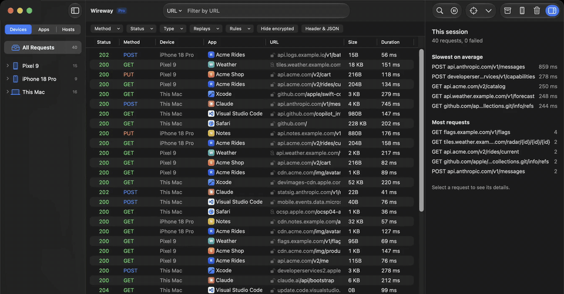
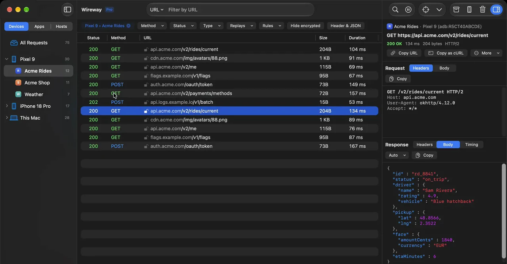
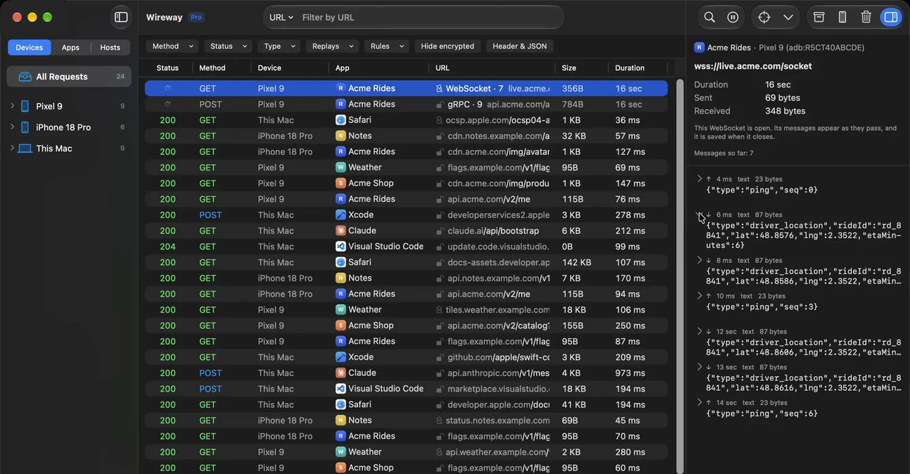
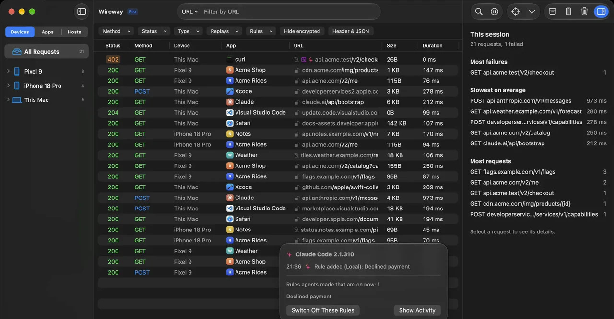

<h1 align="center">Wireway</h1>

<strong>An HTTPS debugging proxy for the apps you build.</strong> 
Point an Android or iOS device, the iOS Simulator or your Mac at it, and see every request and response, HTTPS included.

  
  
  
  

  

Wireway is a commercial app and its source code is not public. This repository is its public home: the
[releases](https://github.com/wireway-dev/wireway/releases) the app updates itself from and the
[issue tracker](https://github.com/wireway-dev/wireway/issues) for bugs and ideas. The website is
[wireway.dev](https://wireway.dev).

## What it does

### See the traffic of each device's apps

Requests and responses, grouped by device and app. JSON, protobuf, gRPC, MessagePack and images are shown readably, and on
Android each request says which app made it.

  

### Watch WebSockets and gRPC as they happen

An open WebSocket shows its messages as they pass, and is saved when it closes. gRPC calls are in the list too.

  

### Change it on the way

Map a host to another server, answer requests locally, rewrite them, pause them at a breakpoint, or slow the connection
down.

### Work with AI agents

Wireway includes an MCP server, so tools such as Claude Code and Codex can read and search the captured traffic, set up
devices and add rules. Everything an agent changes is listed, and can be switched off.

  

## Requirements

A Mac with Apple silicon, running macOS 15 or later.

Wireway is free for personal, non-commercial use, with no account or key. Any other use needs
[Wireway Pro](https://wireway.dev/pricing/).

## Install

No build has been released yet. Once one is:

1. Download the latest `Wireway-<version>-macos-arm64.zip` from [Releases](https://github.com/wireway-dev/wireway/releases).
2. Open the zip and move **Wireway** to your Applications folder.
3. Open Wireway.

Builds are signed with a Developer ID and notarized by Apple.

## Updates

Wireway updates itself. Choose **Wireway > Check for Updates**, or turn on automatic checks in **Settings > General**.
Every update is signed, and Wireway checks the signature before it installs anything. Your settings, captured
traffic and certificate stay as they are.

## Bugs and ideas

[Open an issue](https://github.com/wireway-dev/wireway/issues/new/choose). Issues are public, so leave out anything
private from the traffic you captured: hosts, tokens, cookies, request bodies.

When something fails, a few lines from Wireway's log help a lot. It's at `~/Library/Logs/Wireway/engine.log`, with the
run before in `engine.previous.log`. The log names your Mac's network address and the hosts you decrypt, so paste the
lines around the problem rather than the whole file.

If a HAR file or a saved session would show the problem, say so in the issue and send the file to support instead of
attaching it: exports hide credentials, but URLs and bodies stay as you captured them.

For your license or subscription, or anything you'd rather not post in public, write to
[support@wireway.dev](mailto:support@wireway.dev). For security problems, see [SECURITY.md](SECURITY.md).
